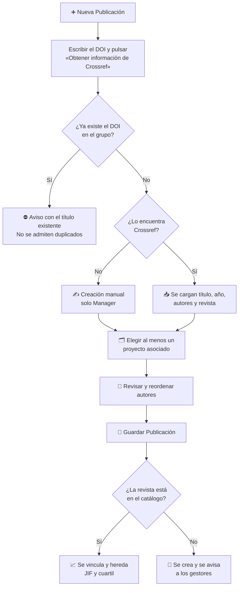

# Publicaciones y Bibliometría

El módulo **Publicaciones** reúne todos los artículos científicos del grupo. Cada publicación se vincula a una o más **revistas**, a sus **autores** y a los **proyectos** que la financiaron, y muestra los indicadores bibliométricos de la revista (factor de impacto, cuartil y categoría).

## 🔎 Listado, búsqueda y filtros \{#listado-búsqueda-y-filtros}

Accede desde **Investigación → Publicaciones**. La tabla muestra, por este orden, el **título**, los **autores**, la **revista** (abreviada), el **año**, las **citas** y la **fecha de creación**. Por defecto se ordena por año descendente y, dentro de cada año, de la más reciente a la más antigua. Los títulos se muestran completos, en varias líneas si hace falta, y un candado verde junto al título indica que la publicación tiene **acceso abierto**.

Los **autores** aparecen como avatares con sus iniciales, en su orden de firma: se ven los tres primeros y un círculo **+N** agrupa al resto (pasa el ratón por encima para ver los nombres). Las **fechas** se muestran en el formato del idioma de la interfaz.

La **misma tabla** se usa en este listado y en la pestaña [Publicaciones del perfil de un miembro](./10-member-profile.md#publicaciones); solo cambia qué publicaciones contiene.

*Listado de publicaciones del grupo, vista de User.*

*Vista de Contributor.*

*Vista de Manager.*

- **Ordenar:** los encabezados **Título**, **Revista**, **Año**, **Citas** y **Fecha de creación** son pulsables (la columna **Autores** no). Cada clic cambia el orden en este ciclo: **descendente → ascendente → sin orden** (vuelve al orden por defecto). El orden se aplica a todo el listado, no solo a la página visible. En **Citas**, las publicaciones sin dato aparecen siempre al final.
- **Búsqueda rápida por título o DOI:** el cuadro superior («Buscar por título o DOI…») filtra mientras escribes. Puedes escribir parte del título o un DOI completo o parcial (por ejemplo `10.1038`).
- **Paginación:** al pie de la tabla eliges cuántas filas ver por página (10, 25, 50 o 100).
- **Qué se puede pulsar:** solo dos columnas son enlaces. El **título** abre la ficha de la publicación y la **revista** abre la [ficha de la revista](./09-journals.md#consultar-una-revista). El resto de celdas (autores, año, citas y fecha) y la fila en sí no responden al clic. El menú de tres puntos de la fila ofrece **Ver**, **Editar** y **Enlace externo** al DOI.

### Filtros avanzados

El botón de filtros (icono de controles) despliega un panel con cuatro selectores de selección múltiple:

- **Autores** y **Revistas**: se buscan escribiendo el nombre.
- **Años**: lista de años desde la publicación más antigua hasta el año actual.
- **Proyectos**: se buscan por código o título.

Pulsa **Aplicar filtros** para confirmarlos; **Limpiar filtros** los elimina. El botón de filtros muestra el número de filtros activos.

*Panel de filtros abierto sobre el listado.*

### Enlaces con filtros compartibles \{#enlaces-con-filtros}

Los filtros, la búsqueda, el orden y la página quedan reflejados en la **dirección (URL)** del navegador. Puedes copiar el enlace y enviarlo: quien lo abra verá el listado con los mismos filtros. El botón «Atrás» del navegador recupera el filtrado anterior.

*Listado abierto desde un enlace con año y orden por fecha de creación.*

| Parámetro | Ejemplo | Efecto |
|---|---|---|
| `search` | `?search=10.1038` | Busca por título o DOI |
| `year` (repetible) | `?year=2026&year=2025` | Filtra por uno o varios años (4 cifras) |
| `author` (repetible) | `?author=01a03ae4-04d3-7957-aa01-047409558f8e` | Filtra por el identificador (UUID) de uno o varios autores |
| `journal` (repetible) | `?journal=<id-revista>` | Filtra por el identificador (UUID) de una o varias revistas |
| `project` (repetible) | `?project=<id-proyecto>` | Filtra por el identificador (UUID) de uno o varios proyectos |
| `sort` | `?sort=createdAt:desc` | Orden `campo:dirección` (`asc` o `desc`). Campos: `year`, `title`, `journal.name`, `citationMetrics.citationsCount`, `createdAt` |
| `page` | `?page=2` | Página del listado |
| `pageSize` | `?pageSize=50` | Filas por página: 10, 25, 50 o 100 |

Se pueden combinar, por ejemplo `?year=2026&sort=createdAt:desc&pageSize=50`. Los parámetros desconocidos o con valores no válidos se ignoran, y los identificadores que no existen simplemente no devuelven resultados.

:::note[Perfil de un miembro]

En la pestaña de publicaciones de un perfil, la persona viene fijada por la propia ficha: no se puede cambiar mediante parámetros de la URL.

:::

## 📄 Consultar una publicación \{#consultar-una-publicación}

La ficha de detalle muestra el título, el año, los autores en su orden de firma, el DOI (con botón para copiarlo), la revista, volumen, número y páginas, los datos de citación de la revista (**JIF**, cuartil y posición en su categoría) y los **proyectos asociados**. La pestaña **Documentos** contiene los ficheros adjuntos.

Los autores vinculados a personal del grupo aparecen resaltados; el resto son autores externos.

*Ficha de una publicación con sus autores, revista, indicadores y proyectos asociados.*

### Citas (OpenAlex) \{#citas-de-openalex}

La columna **Citas** muestra el número de citas de cada publicación según OpenAlex, o «—» si todavía no hay dato. La ficha de detalle incluye el panel **Citas en OpenAlex**, con:

- **Citas totales**.
- Un **percentil** (por ejemplo «Percentil P85–P90»), comparado con publicaciones del mismo año.
- Un **gráfico de barras con las citas por año**; los años sin citas aparecen a 0.
- **Última actualización: fecha** y el enlace **Ver en OpenAlex**.
- Un icono de información que recuerda que los recuentos de OpenAlex difieren de Scopus y suelen ser mayores.

Si aún no hay datos, el panel muestra «Aún no hay datos de OpenAlex.». Estos datos **solo aparecen después de que un Manager actualice las citas** del grupo desde [Conexiones con terceros](../04-administration/05-group-settings.md#citas-de-openalex); además, las publicaciones sin DOI válido o que OpenAlex no conoce se quedan sin dato.

## ➕ Añadir una publicación \{#añadir-una-publicación}

:::info[🔐 Permisos requeridos]

Consulta qué es cada rol en [Modelo de Roles y Accesos](../01-getting-started/02-roles-and-access.md).

| Acción | Quién puede |
|---|---|
| Consultar el listado y las fichas | Cualquier usuario del grupo |
| **Nueva Publicación** (por DOI) | **Contributor**, **Reviewer** y **Manager** |
| **Creación manual (sin DOI)** | Solo **Manager** |
| **Editar** una publicación | Quien la creó, y **Reviewer** y **Manager** |
| **Eliminar** una publicación | Solo **Manager** |

Si no tienes permiso, el botón correspondiente no aparece.

:::

### Importar desde un DOI (recomendado)

Pulsa **Nueva Publicación**. El formulario empieza con la sección **Importación desde DOI**.

*Escribe el DOI y pulsa «Obtener información de Crossref».*

1. Escribe el DOI (por ejemplo `10.1038/s41586-020-2649-2`) y pulsa **Obtener información de Crossref**.
2. Science Manager comprueba primero que el DOI no exista ya en el grupo y, si es nuevo, consulta Crossref.
3. Con los datos importados aparecen el resto de secciones: **Proyectos Asociados**, **Autores**, **Información Básica** (título, año, volumen, número y páginas, no editables) y **Acceso y Enlaces**.
4. Selecciona al menos un proyecto, revisa los autores y pulsa **Guardar Publicación**.

:::warning[Reglas del alta por DOI]

- **No se admiten duplicados:** si ya existe una publicación con ese DOI, se muestra un aviso con su título y no se puede crear otra.
- **El DOI queda bloqueado** tras importar los datos. Para empezar con otro DOI, pulsa **Borrar DOI**, lo que reinicia el formulario.
- **Proyectos Asociados es obligatorio:** hasta que no elijas al menos un proyecto, el botón **Guardar Publicación** permanece desactivado.
- Si Crossref no encuentra el DOI, se te indica que lo rellenes manualmente (opción solo disponible para Managers).

:::

**Así funciona el alta por DOI:**

### Autores y revista

- **Autores:** se precargan desde Crossref en su orden original y puedes arrastrarlos para reordenarlos. Si un autor coincide con personal del grupo (por apellido), se asocia automáticamente; en caso contrario puedes **Asociar usuario** manualmente. Los autores no vinculados se crean como autores externos al guardar.
- **Revista:** si ya existe en la base de datos se vincula y se muestran sus indicadores. Si no existe, se avisa de que se añadirá como revista nueva y se notificará a los gestores para que completen sus datos.
- **Acceso y Enlaces:** puedes indicar una **URL de Acceso Abierto** (la publicación aparecerá con el candado junto al título en el listado) y **Enlaces adicionales** con nombre y URL.

### Creación manual (solo Managers)

Los **Managers** ven en la sección de DOI el enlace **Creación manual (sin DOI)**, pensado para publicaciones que no tienen DOI o que Crossref no encuentra.

*Formulario manual: solo el **Título** y al menos un **Proyecto asociado** son obligatorios.*

Además de los campos de importación, aquí se rellenan a mano el volumen, número, páginas, año, URL, la revista (elegida del catálogo o escribiendo el nombre de una nueva), los autores y los enlaces.

## ✏️ Editar o eliminar \{#editar-o-eliminar}

Desde el menú de la fila o desde la ficha (menú de tres puntos) puedes **Editar** si eres quien creó la publicación o tienes rol Reviewer o superior. El DOI no puede modificarse, y los datos de factor de impacto se gestionan automáticamente. Mientras editas puedes pulsar **Actualizar desde Crossref** para refrescar los metadatos y revisarlos antes de guardar. **Eliminar** solo está disponible para Managers y pide confirmación.

:::tip[Aprovecha los filtros para tus informes]

Combina **Años** y **Proyectos** para localizar rápidamente las publicaciones vinculadas a un proyecto en un periodo, por ejemplo al preparar una memoria de justificación.

:::
