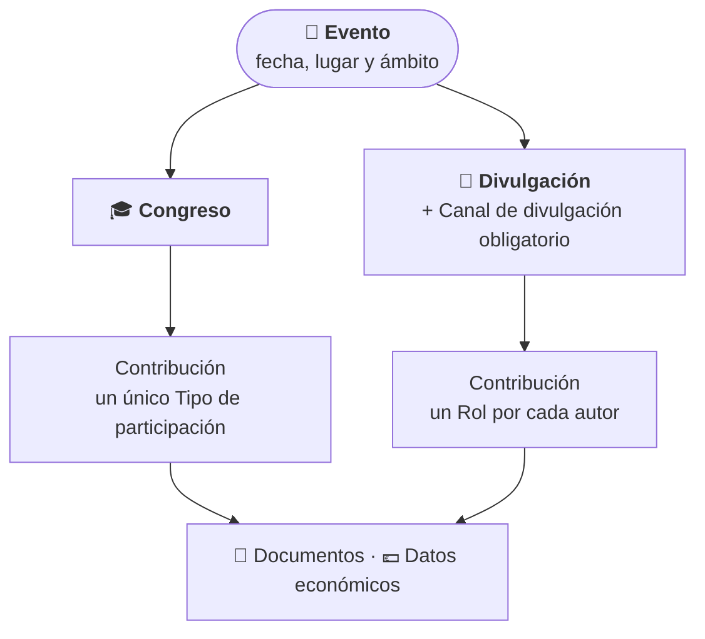
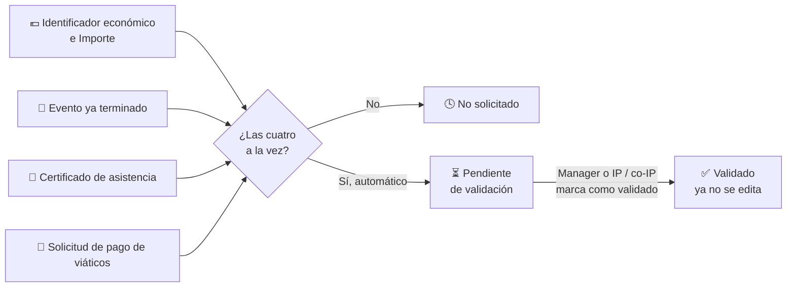

# Eventos y Contribuciones

El módulo **Eventos** registra la actividad de difusión del grupo. Se organiza en dos niveles:

- **Evento:** el acto en sí, con su fecha y lugar. Puede ser un **Congreso** o una actividad de **Divulgación** (feria de ciencias, charla en un instituto, entrevista en radio…).
- **Contribución:** la participación concreta de una o varias personas del grupo en ese evento (una comunicación oral, un póster, una charla, una entrevista…). Un evento puede tener muchas contribuciones.

El **tipo del evento decide cómo se rellenan sus contribuciones**, como se explica más abajo.

## 🗓️ Listado, calendario y filtros \{#listado-calendario-y-filtros}

Accede desde **Investigación → Eventos**. El recorrido de navegación (Inicio · Eventos · …) está en la barra superior, igual que en la ficha de un miembro del equipo. Arriba, el selector **Eventos | Contribuciones** cambia la forma de leer el mismo registro:

- **Eventos:** un evento por fila, del más reciente al más antiguo. Muestra el título (con su tipo y ámbito debajo), el lugar, las fechas y el número de contribuciones. Un evento que está celebrándose hoy lleva la etiqueta **En curso**; uno futuro, **Próximo**.
- **Contribuciones:** todas las contribuciones del grupo en una sola lista, con una columna **Evento**, los autores, la participación y el estado económico.

El título de cada fila es un enlace. También puedes pulsar en cualquier parte de la fila para abrirla.

*Listado de eventos del grupo.*

### Ver las contribuciones de un evento sin salir del listado

Si un evento tiene contribuciones, su fila lleva una flecha a la izquierda. Púlsala para desplegar hasta cinco contribuciones con sus autores, su participación y su estado económico. Pulsa el título de una contribución para abrir su ficha. Desde el mismo desplegable, **Ver las N contribuciones** abre el evento y **Añadir contribución** va directo al formulario (solo si tienes permiso). En el móvil, cada tarjeta lleva un botón **Contribuciones (n)** que hace lo mismo.

### Búsqueda y filtros

- **Búsqueda:** el cuadro superior busca por texto libre. En **Eventos** busca por título, ciudad o país; en **Contribuciones**, por título.
- **Accesos rápidos:** en **Eventos**, **Congresos**, **Divulgación** e **Internacional**; en **Contribuciones**, los cuatro tipos de participación.
- **Calendario** (solo en **Eventos**): el botón despliega un calendario de tres meses (uno en el móvil). Los días con eventos aparecen subrayados; pulsa uno para ver solo los eventos de esa fecha, y quítalo con la **×** del filtro activo.
- **Más filtros:** abre un panel con **Año**, **Autores**, **Proyectos asociados**, **Canal de divulgación**, **Rol** y **País/Ciudad** en Eventos, y con **Autores**, **Proyectos asociados** y **Rol** en Contribuciones. **Aplicar filtros** los confirma y **Limpiar filtros** los quita. El botón muestra cuántos hay activos.
- **Filtros activos:** debajo aparece un chip por cada valor aplicado; la **×** lo quita y **Limpiar todo** quita todos.
- Los filtros, la vista y la página forman parte de la dirección web: si recargas o copias el enlace, otra persona ve lo mismo.

:::info[Orden en la vista Contribuciones]

En **Contribuciones** las filas se ordenan por la fecha de su evento, de la más reciente a la más antigua, dentro de cada página.

:::

*Panel de filtros abierto sobre el listado.*

## 📄 Consultar un evento y sus contribuciones \{#consultar-un-evento-y-sus-contribuciones}

La ficha del evento muestra su título, un estado (**En curso** o **Próximo**, si corresponde), las fechas, el lugar, el tipo, el ámbito y el canal, y el número de contribuciones. En la misma fila de datos aparece **un único dato de procedencia**: «Creado por *Nombre* · fecha» mientras nadie lo haya modificado, y «Última modificación por *Nombre* · fecha» en cuanto alguien lo modifica (entonces ya no se muestra el creador en la cabecera). El nombre enlaza al perfil de la persona. Al pulsar la última modificación se abre el **historial**: cada cambio con quién lo hizo, cuándo y qué campos tocó (nunca los valores), y al final quién creó el evento. Los eventos cargados desde un CSV no tienen creador y muestran solo la fecha.

Arriba a la derecha, a la altura del título, el menú de tres puntos ofrece **Editar evento** y **Eliminar evento**, cada uno con su icono y solo si tienes permiso.

Debajo, la sección **Contribuciones** tiene un buscador por título o autor, en los congresos accesos rápidos por tipo de participación y, en esa misma línea a la derecha, el botón **Añadir contribución**. La tabla muestra el título, los autores (con el nombre del primero), la participación, el proyecto que financia y el estado económico (**Pendiente de validar** o **Validado**).

*Ficha de un congreso con sus contribuciones.*

### Ficha completa de una contribución

La ficha completa muestra arriba el título, la participación, las fechas del evento y el estado económico; en esa misma fila aparece el mismo dato de procedencia que en el evento (creado por, o última modificación por con su historial). El menú de tres puntos de arriba a la derecha, a la altura del título, ofrece **Editar** y **Eliminar**; desde la tabla del evento se llega a esta ficha pulsando la fila, y de aquí se edita. En pantallas grandes se divide en dos columnas: a la izquierda los **autores** (con su rol, y «Sin perfil en el grupo» para quienes no tienen cuenta), los **proyectos** (el que financia la dieta y los asociados), los **documentos** y los **detalles**; a la derecha los **datos económicos** y el **evento**. En el móvil todo se apila en una columna, en ese mismo orden.

### Documentos de la contribución

Todos los documentos están en un único bloque. Cada fila muestra el nombre (puedes pulsarlo para previsualizarlo), el tipo de archivo, el tamaño y la fecha de subida, su **clasificación** y los botones para **descargar** y **eliminar**. Para subir otro archivo, arrástralo al recuadro de abajo o púlsalo (PDF, JPG o PNG, máximo 10 por contribución).

Los botones para subir, clasificar y eliminar documentos solo aparecen a las mismas personas que pueden editar los datos económicos (administrador, Manager del grupo, creador y autores); el resto ve la lista en modo lectura. La clasificación (**Certificado de asistencia**, **Solicitud de pago de viáticos** u **Otro**) se elige en un desplegable en cada fila mientras la economía no esté validada. Una vez validada, se muestra como texto y ya no se puede cambiar.

## 🔐 Permisos requeridos \{#permisos-requeridos}

:::info[🔐 Permisos requeridos]

Consulta qué es cada rol en [Modelo de Roles y Accesos](../01-getting-started/02-roles-and-access.md).

| Acción | Quién puede |
|---|---|
| Consultar eventos y contribuciones | Cualquier usuario del grupo |
| **Nuevo evento** | **Reviewer** y **Manager** |
| **Editar evento** | **Reviewer** y **Manager**, y quien lo creó |
| **Eliminar evento** (y sus contribuciones) | Solo **Manager** |
| **Añadir contribución** | **Contributor**, **Reviewer** y **Manager** |
| **Editar contribución** | **Reviewer** y **Manager**; además, quien la creó, cualquier **autor** con cuenta en el grupo y el **IP o co-IP** del proyecto que financia la dieta o de cualquiera de los proyectos asociados, sea cual sea su rol |
| Editar el **identificador económico** y el **importe**, **clasificar documentos**, **añadir** y **eliminar** documentos | **Administrador**, **Manager** del grupo, quien creó la contribución y cualquier **autor** con cuenta en el grupo. Un **Reviewer** solo si es el creador o un autor |
| **Eliminar contribución** | Solo **Manager** |
| Marcar como revisados los avisos de importación | **Reviewer** y **Manager** |
| Validar los datos económicos | **Manager** y el IP o co-IP del proyecto que financia la dieta |

Un **Reviewer** puede crear eventos y editar cualquier evento o contribución del grupo, pero no los datos económicos ni los documentos de una contribución si no es el creador ni uno de los autores. Si no tienes permiso, el botón no aparece o está deshabilitado.

:::

## ➕ Crear un evento \{#crear-un-evento}

Pulsa **Nuevo evento** en el listado (solo visible si tienes permiso). Todos los campos son obligatorios:

1. **Título** del evento.
2. **Tipo:** **Congreso** o **Divulgación**.
3. **Ámbito:** **Nacional** o **Internacional**.
4. **País** y **Ciudad.** El país viene preseleccionado como España; la ciudad se elige entre las del país.
5. **Fecha de inicio** y **Fecha de fin.**

**Guardar** se habilita cuando el formulario está completo y te lleva a la ficha del evento.

*Formulario de nuevo evento con el país preseleccionado.*

:::warning[El Canal de divulgación depende del tipo]

Al elegir el tipo **Divulgación** aparece el campo **Canal de divulgación** (redes sociales, prensa escrita, radio, televisión, pódcast, feria de ciencias, actividad escolar o universitaria, evento público, taller, exposición, café científico o charla divulgativa), y pasa a ser **obligatorio**. Si cambias el tipo a **Congreso**, el canal se borra, porque un congreso no puede tener canal.

Además, la **Fecha de fin** no puede ser anterior a la **Fecha de inicio**.

:::

*Al elegir Divulgación aparece el Canal de divulgación.*

## ➕ Añadir una contribución \{#añadir-una-contribución}

Desde la ficha del evento, pulsa **Añadir contribución** (junto al título de la sección **Contribuciones**). También puedes hacerlo desde el listado, en el desplegable de un evento. El formulario se adapta al tipo del evento:

| Campo | Congreso | Divulgación |
|---|---|---|
| **Título** | Obligatorio | Obligatorio |
| **Tipo de participación** | Obligatorio (una sola para toda la contribución) | No aparece |
| **Rol** de cada autor | No aparece | Obligatorio para cada autor |
| **Autores** | Al menos uno | Al menos uno |
| **Proyectos asociados** | Obligatorio al crear | Obligatorio al crear |
| **Proyecto que financia la dieta** | Obligatorio al crear | Obligatorio al crear |
| **Agradecimientos**, **Enlaces externos** | Opcionales | Opcionales |

Los tipos de participación de un congreso son **Conferencia invitada**, **Comunicación oral**, **Póster** y **Asistencia**. Los roles de una actividad de divulgación son, entre otros, **Ponente**, **Entrevistado/a**, **Moderador/a**, **Organizador/a**, **Divulgador/a científico/a** o **Participante**.

*Contribución a un congreso: se pide un único Tipo de participación.*

### Autores

Busca a cada persona por su nombre en **Autores**. La lista resultante está **ordenada**: quien ocupa la primera posición (subrayada) figura como **Presentador/a** en un congreso, o como **Primer autor/a** en una actividad de divulgación salvo que su rol implique dirigirse a un público. Usa las flechas para reordenar y la cruz para quitar a alguien.

*En divulgación, cada autor lleva su propio Rol.*

:::warning[Proyecto que financia la dieta]

El **Proyecto que financia la dieta** solo ofrece los proyectos que hayas elegido en **Proyectos asociados**. Si quitas de esa lista el proyecto que estaba seleccionado como financiador, el campo se vacía y debes elegir otro.

:::

### Documentos

Los documentos (PDF, JPG o PNG, **máximo 10**) no se pueden adjuntar al crear la contribución: **guárdala primero** y súbelos desde su ficha o al editarla.

## 💶 Datos económicos de una contribución \{#datos-económicos-de-una-contribución}

La ficha de cada contribución incluye un bloque **Datos económicos** con el **importe**, el **estado**, el **identificador económico** y una lista de **Requisitos para validar** que indica qué se cumple y qué falta:

| Estado | Significado |
|---|---|
| **No solicitado** | Aún no se cumplen todos los requisitos |
| **Pendiente de validación** | Se cumplen todos y se avisa a quien debe validar |
| **Validado** | Un responsable ha confirmado los datos; ya no se pueden editar |

Mientras la contribución no esté validada y seas **administrador**, **Manager** del grupo, el **creador** o uno de sus **autores**, el bloque incluye los campos **Identificador económico** e **Importe** con el botón **Guardar**. Una vez validada, todo se muestra como texto.

*Ficha de una contribución: a la derecha, los datos económicos con sus requisitos.*

**Del registro a la validación económica:**

:::info[Cuándo pasa a Pendiente de validación]

El paso es **automático** cuando se cumplen a la vez las cuatro condiciones:

- Hay **Identificador económico** y **Importe**.
- El evento **ya ha terminado** (su fecha de fin es hoy o anterior).
- Hay al menos un documento clasificado como **Certificado de asistencia**.
- Hay al menos un documento clasificado como **Solicitud de pago de viáticos**.

Clasifica cada documento adjunto en el bloque **Documentos**, con el desplegable de su fila (**Certificado de asistencia**, **Solicitud de pago de viáticos** u **Otro**).

:::

Cuando el estado es **Pendiente de validación**, el **Manager** o el IP o co-IP del proyecto que financia la dieta ve el botón **Marcar como validado** y debe confirmar la acción. Una contribución sin proyecto financiador solo la puede validar un Manager.

## ⚠️ Avisos de importación \{#avisos-de-importación}

Los eventos y contribuciones cargados desde un CSV pueden llevar la nota **Notas de importación — pendiente de revisión** con los datos que faltaban. Un **Reviewer** o **Manager** corrige los datos y pulsa **Marcar como revisado** para descartar el aviso.

:::tip[Registra los eventos al terminar la actividad]

Crea el evento y sus contribuciones en cuanto se celebre y sube enseguida el certificado de asistencia y la solicitud de viáticos: así la contribución pasa a **Pendiente de validación** sin más trámites.

:::
