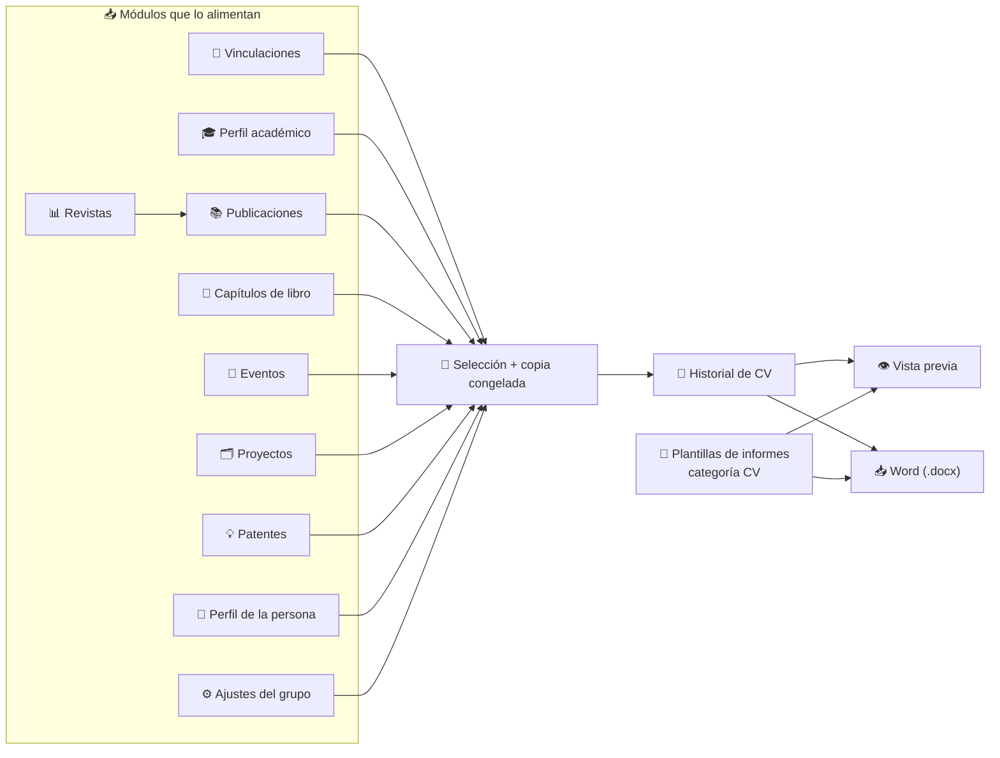

# Currículum (CV) de una Persona

La pestaña **CV** del [perfil de una persona](./10-member-profile.md) genera currículums en formato **CVA** a partir de los datos que ya existen en Science Manager. No se escribe nada dos veces: eliges qué publicaciones, proyectos, congresos, patentes, capítulos, titulaciones y contratos quieres incluir, añades unos textos libres y descargas un documento Word.

Se llega desde **Equipo → Equipo →** nombre de la persona **→ CV**. La dirección tiene la forma `/<grupo>/teams/<nombre-apellido>/cv`.

:::info[🔐 Permisos requeridos]

Consulta qué es cada rol en [Modelo de Roles y Accesos](../01-getting-started/02-roles-and-access.md). Todo se aplica siempre dentro de tu propio grupo.

| Acción | Quién puede |
|---|---|
| Ver la pestaña **CV**, **generar**, **previsualizar**, **descargar** y **clonar** | La propia persona, **Reviewer** y **Manager** |
| **Eliminar** un CV | La propia persona y **Manager** |

Un **Reviewer** puede preparar y descargar el CV de cualquier miembro del grupo, pero no borrarlo. Un **Contributor** o un **User** solo ven la pestaña en su propio perfil; en el de otra persona no aparece, y si escriben la dirección a mano se muestra un aviso de acceso denegado. Quien no puede ver los CV de una persona tampoco los recibe por la API.

:::

## 🗂️ Historial de CV \{#historial-de-cv}

Al abrir la pestaña ves la lista de CV ya generados para esa persona, del más reciente al más antiguo y con 10 por página:

| Columna | Qué muestra |
|---|---|
| **Título** | Nombre que se le dio al CV. |
| **Creado** | Fecha de creación. |
| **Creado por** | Quién lo generó (puede ser la propia persona o un Reviewer / Manager). |
| **Contenido** | Etiquetas con el nº de elementos elegidos en cada apartado: puestos, titulaciones, publicaciones, capítulos de libro, congresos, proyectos y patentes. Solo aparecen los que no están vacíos. |

Cada fila tiene cuatro iconos de acción:

- **Descargar Word:** elige plantilla e idioma y descarga un `.docx`.
- **Vista previa:** muestra el documento en pantalla antes de descargarlo.
- **Clonar selección:** abre el generador con la misma selección y los mismos textos, para crear una versión nueva.
- **Eliminar:** pide confirmación y no se puede deshacer.

Si todavía no hay ninguno, aparece «Aún no se ha generado ningún CV».

*Pestaña **CV** vista por un Reviewer: puede generar, previsualizar, descargar y clonar, pero no ve el icono de eliminar.*

## ✍️ Generar un CV nuevo \{#generar-un-cv-nuevo}

Pulsa **Generar nuevo CV**. El formulario sigue los apartados del modelo CVA:

*Generador de CV: el apartado A.1 muestra los datos de solo lectura y los apartados con tabla aparecen plegados, con su contador de elementos.*

| Apartado | Qué se rellena | Origen de los datos |
|---|---|---|
| **Título del CV** | Obligatorio, hasta 150 caracteres. Por defecto «CVA – fecha de hoy». | Lo escribes tú. |
| **A.1 Situación profesional actual** | Tabla de solo lectura (puesto, fecha de inicio, organismo, departamento / centro, país y teléfono) y **Palabras clave** (hasta 500 caracteres, separadas por punto y coma). | Contrato activo, datos del grupo y perfil de la persona. |
| **A.2 Situación profesional anterior** | Selección de contratos. | [Vinculaciones](./06-employment-records.md). |
| **A.3 Indicadores generales de calidad** | Texto libre de hasta 2000 caracteres. | Lo escribes tú. |
| **A.4 Formación académica** | Selección de titulaciones. | [Perfil académico](./03-academic-direction.md). |
| **B. Resumen libre** | Texto con **negrita**, *cursiva*, listas con viñetas y numeradas. Máximo 3500 caracteres de texto visible. | Lo escribes tú. |
| **C.1 Publicaciones** y **Capítulos de libro** | Selección. | [Publicaciones](./02-publications.md) y [Capítulos de Libro](./07-book-chapters.md). |
| **C.2 Congresos** | Selección de contribuciones. | [Eventos y Divulgación](./05-events.md). |
| **C.3 Proyectos** | Selección. | [Proyectos](./01-projects.md). |
| **C.4 Patentes** | Selección. | [Patentes](./06-patents.md). |

En cada tabla de selección puedes marcar filas una a una, usar la casilla de la cabecera para marcar todas las **visibles** y filtrar con el cuadro de búsqueda («Buscar en …»), que busca en el texto de todas las columnas. Un contador indica cuántas has elegido de las disponibles. Pulsa **Guardar CV** para crearlo.

*Apartado **C.1 Publicaciones** desplegado, con tres publicaciones marcadas y el cuartil / JIF de cada revista.*

:::tip[Aprovecha el CV anterior]

Al abrir el generador, **Palabras clave**, **Indicadores de calidad** y **Resumen libre** vienen rellenos con los del último CV de esa persona. Solo tienes que elegir qué elementos incluir. Con **Clonar selección** también se conservan los elementos elegidos; los que ya no existan se descartan en silencio.

:::

:::warning[Un CV es una fotografía]

Al guardar, el contenido se **congela**: si después editas un proyecto, corriges una publicación o cambia el contrato de la persona, los CV ya generados **no cambian**. Para reflejar los cambios, clona el CV y guarda uno nuevo. Esto incluye datos personales como el DNI, la fecha de nacimiento y el teléfono, que quedan guardados dentro del CV.

:::

Si cancelas con cambios sin guardar, se pide confirmación para descartarlos.

## 🔗 Cómo se relaciona con el resto del sistema \{#relacion-con-el-sistema}

El CV no tiene datos propios más allá de los textos libres y la selección: **lee** de otros módulos y **guarda una copia** de lo elegido.

### Qué elementos se ofrecen para elegir

El generador solo ofrece lo que está vinculado a la persona del perfil:

| Apartado | Se ofrece cuando… |
|---|---|
| Contratos | Son sus **Vinculaciones**. Se marca como **Actual** el que está en vigor hoy. |
| Titulaciones | Pertenecen a su **Perfil académico**. |
| Publicaciones | La persona figura como **autora** o es quien la registró. Cada una muestra el **cuartil y JIF** de su revista en ese año, tomados de [Revistas](./09-journals.md). |
| Capítulos de libro y patentes | La persona figura como **autora** o es quien los registró. |
| Congresos | La persona figura como autora de la contribución y el evento es de tipo **Congreso**. Las actividades de **Divulgación** no se incluyen. |
| Proyectos | Participa en él con cualquier papel: **IP**, equipo de investigación o equipo de trabajo. Se indica **IP** o **Miembro**; el importe es el final si existe, o el total. |

Esto significa que, para que algo aparezca en el CV, antes tiene que estar registrado en su módulo y asociado a la persona (como autora o miembro). Si falta una publicación, el arreglo está en [Publicaciones](./02-publications.md), no en el CV.

### De dónde salen los datos personales

- **Persona:** nombre, apellidos, sexo, fecha de nacimiento, DNI, web, correo, ORCID y teléfono (el principal, o el primero registrado). Se editan en [Equipo](./06-team.md).
- **Grupo:** entidad beneficiaria, instituto, centro y país, que se configuran en [Ajustes del Grupo](../04-administration/05-group-settings.md).
- **Puesto y fecha de inicio (A.1):** salen del contrato activo. Si la persona no tiene ninguno, esos dos campos quedan vacíos y se avisa con «Sin vinculación activa registrada actualmente».

La tabla **A.1** de solo lectura muestra exactamente lo que se imprimirá, así que puedes comprobarlo antes de guardar.

## 📥 Vista previa y descarga \{#vista-previa-y-descarga}

Tanto **Vista previa** como **Descargar Word** abren un diálogo con dos selectores:

- **Plantilla:** por defecto **CVA 2026**, la plantilla base del sistema. También aparecen las plantillas de categoría **CV** que tu grupo haya creado en **Administración → Plantillas de informes** (ver [Informes del Grupo](../03-reporting/02-group-reports.md)).
- **Idioma:** **Español** o **Inglés**, según el idioma de la aplicación al abrir el diálogo. Cambia los rótulos fijos del documento, no los textos que tú escribiste.

El archivo se llama `cv-<nombre-apellido>-<aaaammdd>__<plantilla>.docx`, por ejemplo `cv-carlos-garcia-20261013__cva-2026.docx`. La plantilla y el idioma se eligen **al descargar**, no al guardar, así que un mismo CV se puede obtener en varios formatos e idiomas.

*Diálogo **Descargar CV**: plantilla CVA 2026 e idioma Español.*

*La **Vista previa** muestra el documento con la misma plantilla e idioma antes de descargarlo.*

:::note[El resumen libre se limpia]

Del resumen libre solo se conservan párrafos, negrita, cursiva y listas. Si pegas texto desde Word o una web, llega como texto plano y se pierden colores, tamaños o enlaces.

:::

## ❓ Problemas frecuentes \{#problemas-frecuentes}

| Situación | Qué ocurre y cómo resolverlo |
|---|---|
| No veo la pestaña **CV** en el perfil de un compañero | Es lo esperado si tu rol es **Contributor** o **User**. Solo la ven la propia persona, Reviewer y Manager. |
| Una publicación o patente no aparece para elegir | La persona no figura como autora ni la registró. Asocia su autoría en el módulo correspondiente. |
| El puesto y el año de inicio salen vacíos en A.1 | No hay una vinculación activa. Un Manager puede añadirla en la pestaña [Vinculaciones](./10-member-profile.md#vinculaciones). |
| No puedo guardar | El título está vacío o el **Resumen libre** supera los 3500 caracteres. El contador se pone en rojo. |
| El CV no refleja un cambio reciente | Es una fotografía: clona el CV y guarda uno nuevo. |
