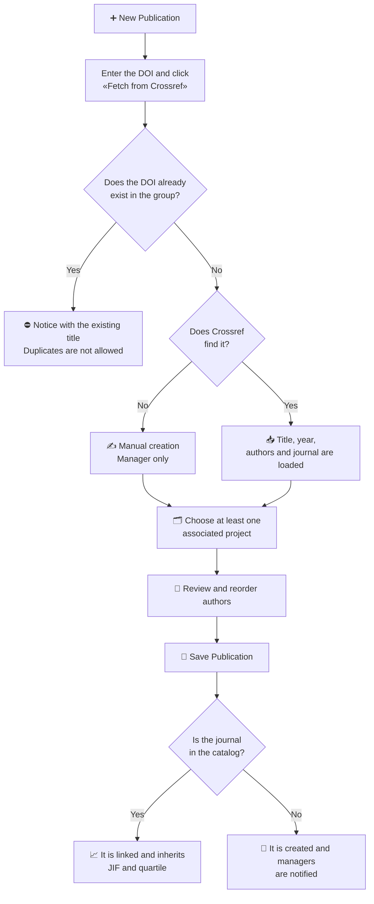

# Publications and Bibliometrics

The **Publications** module gathers all of the group's scientific articles. Each publication is linked to one or more **journals**, its **authors**, and the **projects** that funded it, and it shows the journal's bibliometric indicators (impact factor, quartile, and category).

## 🔎 List, search, and filters \{#listado-búsqueda-y-filtros}

Open it from **Research → Publications**. The table shows, in this order, the **title**, the **authors**, the **journal** (abbreviated), the **year**, the **citations**, and the **creation date**. By default it is sorted by year descending and, within each year, from newest to oldest. Titles are shown in full, over several lines if needed, and a green padlock next to the title indicates that the publication is **open access**.

**Authors** appear as avatars with their initials, in signing order: the first three are shown and a **+N** circle groups the rest (hover to see the names). **Dates** are shown in the format of the interface language.

The **same table** is used in this list and in the [Publications tab of a member's profile](/docs/en/core-features/member-profile#publicaciones); only the publications it contains change.

*The group's publications list, User view.*

*Contributor view.*

*Manager view.*

- **Sorting:** the **Title**, **Journal**, **Year**, **Cited by**, and **Created at** headers are clickable (the **Authors** column is not). Each click changes the order in this cycle: **descending → ascending → no order** (back to the default order). Sorting applies to the whole list, not just the visible page. On **Cited by**, publications with no data always appear last.
- **Quick search by title or DOI:** the box at the top ("Search by title, DOI or year…") filters as you type. You can type part of the title or a full or partial DOI (for example `10.1038`).
- **Pagination:** at the bottom of the table you choose how many rows to see per page (10, 25, 50, or 100).
- **What can be clicked:** only two columns are links. The **title** opens the publication record and the **journal** opens the [journal record](/docs/en/core-features/journals#consultar-una-revista). The other cells (authors, year, citations, and date) and the row itself do not respond to clicks. The row's three-dot menu offers **View**, **Edit**, and **External link** to the DOI.

### Advanced filters

The filters button (controls icon) opens a panel with four multi-select dropdowns:

- **Authors** and **Journals**: searched by typing the name.
- **Years**: list of years from the oldest publication to the current year.
- **Projects**: searched by code or title.

Click **Apply filters** to confirm them; **Clear filters** removes them. The filters button shows the number of active filters.

*Filter panel open over the list.*

### Shareable filter links \{#enlaces-con-filtros}

Filters, search, sorting, and page are reflected in the browser's **address (URL)**. You can copy the link and send it: whoever opens it will see the list with the same filters. The browser's "Back" button restores the previous filtering.

*List opened from a link with a year and sorted by creation date.*

| Parameter | Example | Effect |
|---|---|---|
| `search` | `?search=10.1038` | Searches by title or DOI |
| `year` (repeatable) | `?year=2026&year=2025` | Filters by one or more years (4 digits) |
| `author` (repeatable) | `?author=12` | Filters by the ID of one or more authors |
| `journal` (repeatable) | `?journal=5` | Filters by the ID of one or more journals |
| `project` (repeatable) | `?project=8` | Filters by the ID of one or more projects |
| `sort` | `?sort=createdAt:desc` | `field:direction` order (`asc` or `desc`). Fields: `year`, `title`, `journal.name`, `citationMetrics.citationsCount`, `createdAt` |
| `page` | `?page=2` | List page |
| `pageSize` | `?pageSize=50` | Rows per page: 10, 25, 50, or 100 |

They can be combined, for example `?year=2026&sort=createdAt:desc&pageSize=50`. Unknown parameters or those with invalid values are ignored, and IDs that do not exist simply return no results.

:::note[A member's profile]

In the publications tab of a profile, the person is fixed by the record itself: it cannot be changed through URL parameters.

:::

## 📄 Viewing a publication \{#consultar-una-publicación}

The detail page shows the title, the year, the authors in signing order, the DOI (with a button to copy it), the journal, volume, issue, and pages, the journal's citation data (**JIF**, quartile, and position in its category), and the **associated projects**. The **Documents** tab contains the attached files.

Authors linked to group staff are highlighted; the rest are external authors.

*A publication record with its authors, journal, indicators, and associated projects.*

### Citations (OpenAlex) \{#citas-de-openalex}

The **Cited by** column shows each publication's number of citations according to OpenAlex, or "—" if there is no data yet. The detail page includes the **OpenAlex citations** panel, with:

- **Total citations**.
- A **percentile** (for example "Percentile P85–P90"), compared with publications of the same year.
- A **bar chart of citations per year**; years with no citations appear as 0.
- **Last updated: date** and the **View in OpenAlex** link.
- An info icon reminding you that OpenAlex counts differ from Scopus and are usually higher.

If there is no data yet, the panel shows "No OpenAlex data yet.". This data **only appears after a Manager updates the group's citations** from [Third-Party Connections](../04-administration/05-group-settings.md#citas-de-openalex); also, publications with no valid DOI or unknown to OpenAlex are left without data.

## ➕ Adding a publication \{#añadir-una-publicación}

:::info[🔐 Required permissions]

See what each role is in [Roles and Access Model](/docs/en/getting-started/roles-and-access).

| Action | Who can |
|---|---|
| View the list and records | Any user in the group |
| **New Publication** (by DOI) | **Contributor**, **Reviewer**, and **Manager** |
| **Manual creation (no DOI)** | **Manager** only |
| **Edit** a publication | Whoever created it, and **Reviewer** and **Manager** |
| **Delete** a publication | **Manager** only |

If you do not have permission, the corresponding button does not appear.

:::

### Import from a DOI (recommended)

Click **New Publication**. The form starts with the **Import from DOI** section.

*Enter the DOI and click "Fetch from Crossref".*

1. Enter the DOI (for example `10.1038/s41586-020-2649-2`) and click **Fetch from Crossref**.
2. Science Manager first checks that the DOI does not already exist in the group and, if it is new, queries Crossref.
3. With the imported data, the remaining sections appear: **Associated Projects**, **Authors**, **Basic Information** (title, year, volume, issue, and pages, not editable), and **Access and Links**.
4. Select at least one project, review the authors, and click **Save Publication**.

:::warning[DOI import rules]

- **Duplicates are not allowed:** if a publication with that DOI already exists, a notice with its title is shown and another cannot be created.
- **The DOI is locked** after importing the data. To start with a different DOI, click **Clear DOI**, which resets the form.
- **Associated Projects is mandatory:** until you choose at least one project, the **Save Publication** button stays disabled.
- If Crossref does not find the DOI, you are told to fill it in manually (an option available only to Managers).

:::

**How DOI creation works:**

### Authors and journal

- **Authors:** they are preloaded from Crossref in their original order and you can drag them to reorder. If an author matches group staff (by surname), they are linked automatically; otherwise you can **Link user** manually. Unlinked authors are created as external authors on save.
- **Journal:** if it already exists in the database it is linked and its indicators are shown. If it does not exist, you are told it will be added as a new journal and managers will be notified to complete its data.
- **Access and Links:** you can provide an **Open Access URL** (the publication will appear with the padlock next to the title in the list) and **Additional links** with a name and URL.

### Manual creation (Managers only)

**Managers** see the **Manual creation (no DOI)** link in the DOI section, intended for publications that have no DOI or that Crossref cannot find.

*Manual form: only the **Title** and at least one **Associated project** are required.*

Besides the import fields, here you fill in by hand the volume, issue, pages, year, URL, the journal (chosen from the catalog or by typing the name of a new one), the authors, and the links.

## ✏️ Edit or delete \{#editar-o-eliminar}

From the row menu or from the record (three-dot menu) you can **Edit** if you created the publication or have the Reviewer role or higher. The DOI cannot be changed, and impact factor data is managed automatically. While editing you can click **Update from Crossref** to refresh the metadata and review it before saving. **Delete** is only available to Managers and asks for confirmation.

:::tip[Use filters for your reports]

Combine **Years** and **Projects** to quickly find the publications linked to a project in a given period, for example when preparing a justification report.

:::
