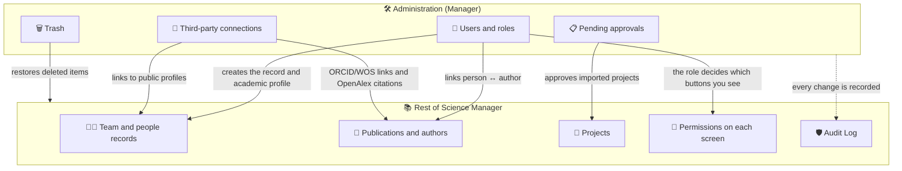

# Admin Panel

The **Admin Panel** is the entry point to all the tools the group manager uses to maintain Science Manager: people, approvals, imports, integrations, and data cleanup. Open it from **Administration → Administration** in the side menu.

:::info[🔐 Required permissions]

See what each role is in [Roles and Access Model](/docs/en/getting-started/roles-and-access).

The panel and most of its tools are exclusive to the **Manager** role. The **Reviewer** only sees the **Audit Log** and the **Report templates** in the menu. The **Contributor** and **User** roles do not see the *Administration* section.

:::

*Admin Panel as seen by a Manager.*

## 🧰 What is in the panel \{#que-hay-en-el-panel}

Each card leads to a tool. Click it to open it.

| Card | What it is for | Page |
|---|---|---|
| **Group Details** | The group's institutional data (name, center, institute, website…). | [Group settings](./05-group-settings.md) |
| **User Management** | Create, edit, roles, account status, and links to authors. | [User Management](/docs/en/administration/user-management) |
| **Pending Approvals** | Approve or reject imported projects awaiting a decision. | [Pending approvals](/docs/en/administration/pending-approvals) |
| **Manage publications** | Enrich publications with Crossref and link them to projects in bulk. | [Publications](../02-core-features/02-publications.md) |
| **Import publications by DOI** | Create publications from their DOI. | [Publications](../02-core-features/02-publications.md) |
| **Import Events CSV** | Bulk upload of events and contributions. | [Events](/docs/en/core-features/events) |
| **Projects** | Management of research projects. | [Projects](/docs/en/core-features/projects) |
| **Audit Log** | History of changes on the platform. | [Audit and trash](/docs/en/administration/audit-and-trash) |
| **Third-Party Connections** | OpenAlex key (citations) and ORCID / ResearcherID URLs. | [Group settings](./05-group-settings.md) |
| **UI Reference** and **System settings** | Technical tools for the Administrator role. | — |

Shared catalogs (authors, funding bodies, and journals) have no card here: they are opened from **Consultation** in the menu and explained in [Catalogs and Entities](/docs/en/administration/master-data).

:::note[Technical cards]

**UI Reference** and **System settings** belong to the Administrator role (the one who maintains the installation). Even if the card shows in the panel, a Manager cannot open them.

:::

## 🔗 How it connects to the rest of the system \{#como-se-conecta}

What you do in Administration is not isolated: it feeds the modules the rest of the group uses. This diagram summarizes the relationships.

In practice:

- **Users give identity to the rest of the system.** A registered person appears in [Team](/docs/en/core-features/team), can be principal investigator of a [project](/docs/en/core-features/projects), and receives permissions according to their role. Their contract data is managed in [Employment records](/docs/en/core-features/employment-records).
- **The user ↔ author link ties the person to their output.** [Publications](../02-core-features/02-publications.md) are signed by *authors*; when you link an author to a user, those publications appear in their [profile](/docs/en/core-features/member-profile) and can be edited by their author.
- **The role governs every screen.** Changing someone's role in User Management immediately changes which buttons they see (for example, **New Project** only appears to Reviewers and Managers).
- **Everything is per group.** A Manager only manages users and data of their own group.
- **Nothing is lost without a trace.** Edits are recorded in the [Audit Log](/docs/en/administration/audit-and-trash) and deleted items go to the **Trash**, from where a Manager can restore them.
